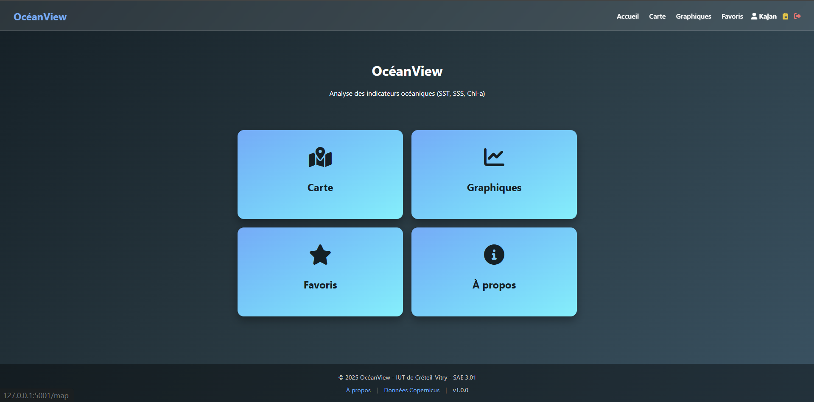

# OcéanView · Données marines sur carte et graphiques

OcéanView est une application web consacrée à l’exploration des données marines. Elle permet de consulter la température de surface (SST), la salinité de surface (SSS) ainsi que la concentration en chlorophylle-a (Chl-a) dans différentes zones maritimes européennes. Grâce à une carte interactive, des graphiques et des filtres par zone et par période, l’utilisateur peut comparer les mesures et suivre leur évolution dans le temps.

Dans ce projet universitaire, nous avons utilisé les données de [Copernicus Marine](https://marine.copernicus.eu/) couvrant les années **2024 et 2025**. Le dépôt inclut l’export complet des données marines utilisées par l’application : **17 421 439 mesures**, **202 201 positions** et **3 indicateurs**. Les dates disponibles vont du **1er décembre 2024 au 2 novembre 2025** pour SST et SSS, et jusqu’au **5 octobre 2025** pour la chlorophylle-a.

## Aperçu du site

### Accueil

Page d’accueil donnant accès à la carte interactive, aux graphiques et aux favoris de l’utilisateur.

### Carte d’intensité

Visualisation de la température de surface (SST). Les filtres permettent de choisir l’indicateur, la zone géographique et la période à explorer. [Voir aussi la carte de points](docs/carte-demo.jpg).

### Graphique d’évolution

Évolution de la concentration en chlorophylle-a (Chl-a), exprimée en mg/m³, sur la période sélectionnée.

## Lancer en local

Préparer **Python 3.12 avec pip** et **MySQL 8.0 ou 8.4**.

[Télécharger le dépôt](https://github.com/Kajan94/Oceanview/archive/refs/heads/main.zip), le décompresser, puis ouvrir un terminal à sa racine. Le fichier `data/oceanview.zip` contient l’export complet des trois tables marines, soit environ **248 Mo compressés**. Il doit rester à cet emplacement, sans être décompressé manuellement.

L’import de plus de 17 millions de mesures peut prendre plusieurs minutes et nécessite plusieurs Go d’espace libre pour MySQL. La progression s’affiche dans le terminal.

### Préparer MySQL

Avec un compte d’administration MySQL, créer une **nouvelle base vide** pour l’installation locale :

~~~sql
CREATE DATABASE oceanview_local CHARACTER SET utf8mb4;
CREATE USER 'oceanview'@'127.0.0.1' IDENTIFIED BY 'mot-de-passe-local-a-choisir';
GRANT ALL PRIVILEGES ON oceanview_local.* TO 'oceanview'@'127.0.0.1';
~~~

### Configurer la connexion MySQL

Ouvrir le fichier [`instance/config.py`](instance/config.py), déjà inclus dans le dépôt, et renseigner le mot de passe MySQL dans `DB_PASSWORD`. Adapter `DB_USER` si un autre compte est utilisé et vérifier le nom de la base : `DB_NAME = 'oceanview_local'`.

### Installer, importer et démarrer

~~~sh
python -m pip install -r requirements.txt
python -m flask --app run init-db
python run.py
~~~

Sur macOS ou Linux, utiliser `python3` à la place de `python` si nécessaire.

Ouvrir [localhost:5001](http://127.0.0.1:5001), créer un compte depuis **Inscription**, puis se connecter pour accéder à la carte et aux graphiques.

La commande `init-db` vérifie l’intégrité de l’archive, crée le schéma et importe les données originales. Elle refuse une base contenant déjà des tables.

Pour les lancements suivants, exécuter uniquement :

~~~sh
python run.py
~~~

Une connexion Internet est nécessaire pour les fonds de carte et les bibliothèques JavaScript externes.

Si le dépôt est récupéré avec Git plutôt qu’avec le ZIP, installer Git LFS avant le clonage :

~~~sh
git lfs install
git clone https://github.com/Kajan94/Oceanview.git
cd Oceanview
git lfs pull
~~~

## Administration

L’espace `/admin/dashboard` est accessible aux comptes ayant le rôle **Admin**. Il rassemble trois vues :

- **Utilisateurs** : consulter les comptes, créer ou modifier un utilisateur, changer son rôle et supprimer un compte. L’administrateur connecté est protégé contre la suppression de son propre compte.
- **Logs système** : consulter l’historique récent des actions, leur date, l’utilisateur concerné et le détail.
- **Avis utilisateurs** : lire les notes et les commentaires laissés sur le site.

Après l’import, créer un administrateur local avec une adresse encore inutilisée dans cette base :

~~~sh
python -m flask --app run create-admin --email admin@example.test
~~~

Choisir un mot de passe d’au moins **8 caractères**, puis le confirmer. Se connecter ensuite au site avec ce compte.

## Architecture

[Voir le schéma d’architecture du projet](docs/architecture-oceanview.png)

Le projet a traité les données Copernicus Marine en Python avant de les charger dans MySQL. L’API Flask sert les mesures sélectionnées par zone, indicateur et période. Leaflet affiche la carte et Plotly les graphiques.

## Organisation du code

| Chemin | Rôle |
| --- | --- |
| `app/controllers/` | Routes Flask et API utilisée par la carte et les graphiques. |
| `app/models/` | Connexion MySQL, requêtes et accès aux comptes. |
| `app/templates/` et `app/static/` | Pages, carte et graphiques. |
| `app/schema.sql` | Structure MySQL des données marines et des tables de l’application. |
| `app/setup_database.py` | Vérification de l’archive, import de la base complète et création d’un administrateur local. |
| `data/oceanview.zip` | Export complet des tables `variable`, `localisation` et `mesure`, conservé avec Git LFS. |

[Projet dans le portfolio](https://kajan94.github.io/Portefolio/#oceanview)

## Travail en équipe

Projet universitaire réalisé à cinq en **deuxième année de BUT Informatique** à l’IUT de Créteil-Vitry (UPEC). Nous avons partagé les tâches entre le travail sur les données et le développement de l’application. Les crédits de l’équipe figurent aussi dans la page **À propos**.
