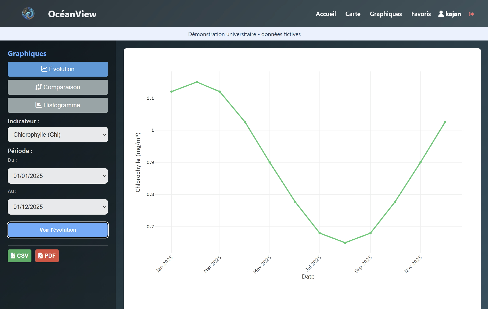

# OcéanView · Données marines sur carte et graphiques

Projet d’équipe réalisé à cinq en BUT Informatique à l’IUT de Créteil-Vitry. L’application associe une API Flask, une base MySQL, une carte Leaflet et des graphiques Plotly pour explorer la température et la salinité de surface ainsi que la chlorophylle-a.

## Aperçu du site

### Accueil

[](docs/accueil-oceanview.png)

Page d’accueil du site Web.

### Carte d’intensité

[](docs/carte-chaleur-oceanview.jpg)

Exemple d'une capture de la carte d'intensité de la demo.

### Graphique d’évolution

[](docs/graphique-chlorophylle.png)

Évolution de la chlorophylle-a, avec les titres des axes et l’unité de mesure. Chaque capture s’ouvre en taille complète en cliquant dessus.

## Exemple de démo du site

1. Créer un compte de démonstration, puis ouvrir **Carte**.
2. Sélectionner **Europe (Global)**, **Température (SST)** et **Carte d’intensité**, puis choisir le **1er août 2025 dans les deux dates**. Les points plus nombreux et les variations entre régions rendent les zones de couleur plus visibles. Une seule date évite de superposer plusieurs mois au même endroit.
3. Comparer avec **Salinité (SSS)** sur l’Europe pour observer le contraste de la Baltique, puis avec **Chlorophylle (Chl-a)** dans la Manche. Les variations sont fictives et servent à illustrer les filtres et les visualisations.
4. Passer en **Carte de points** : le jeu de démo contient **421 valeurs par indicateur et par date**, soit **5 052 valeurs par indicateur** sur les 12 dates de 2025, avant le regroupement selon le zoom.
5. Dans **Graphiques → Évolution**, choisir la période du 1er janvier au 1er décembre 2025. Le tracé présente **12 valeurs**. La carte et les graphiques proposent aussi des exports CSV et PDF.

L’application d’origine a utilisé des données de [Copernicus Marine](https://marine.copernicus.eu/) pour 2024–2025. L’installation ci-dessous génère **15 156 mesures fictives**, réparties sur **421 positions**, 12 dates et 3 variables. Les points couvrent la Manche, le golfe de Gascogne, la Méditerranée occidentale, l’Atlantique et la Baltique. [Aperçu de la carte de points](docs/carte-demo.jpg)

## Lancer en local

Préparer Python 3.12 ou 3.14 et MySQL 8.4. Avec un compte d’administration MySQL, exécuter ce script.

~~~sql
CREATE DATABASE oceanview_demo CHARACTER SET utf8mb4;
CREATE USER 'oceanview'@'127.0.0.1' IDENTIFIED BY 'mot-de-passe-local-a-choisir';
GRANT ALL PRIVILEGES ON oceanview_demo.* TO 'oceanview'@'127.0.0.1';
~~~

Depuis la racine du dépôt, créer un environnement virtuel et le fichier de configuration local.

### Windows PowerShell

```powershell
python -m venv .venv
.\.venv\Scripts\Activate.ps1
New-Item -ItemType Directory -Force instance
Copy-Item config.example.py instance/config.py
```

### macOS ou Linux

```sh
python -m venv .venv
source .venv/bin/activate
mkdir -p instance
cp config.example.py instance/config.py
```

Renseigner le mot de passe MySQL choisi dans `instance/config.py`, puis installer les dépendances, initialiser les données et démarrer l’application.

~~~sh
python -m pip install -r requirements.txt
python -m flask --app run init-demo
python run.py
~~~

Ouvrir [localhost:5001](http://127.0.0.1:5001). La carte et les graphiques chargent des ressources externes. 

## Administration

L’espace `/admin/dashboard` est accessible aux comptes ayant le rôle **Admin**. Il rassemble trois vues.

- **Utilisateurs** — Consulter la liste des comptes, créer ou modifier un utilisateur, changer son rôle et supprimer un compte. L’administrateur connecté est protégé contre la suppression de son propre compte.
- **Logs système** — Consulter l’historique récent des actions enregistrées, avec leur date, l’utilisateur concerné et le détail.
- **Avis utilisateurs** — Lire les notes et les commentaires laissés sur le site.

Pour créer un compte administrateur dans la base de démonstration, exécuter la commande suivante depuis l’environnement Python du projet, avec une adresse encore inutilisée dans cette base.

~~~sh
python -m flask --app run init-demo --admin-email kajan@example.test
~~~

Choisir un mot de passe d’au moins **8 caractères**, puis le confirmer. Démarrer le site avec `python run.py` et se connecter avec le compte créer.
## Architecture

[Voir le schéma d’architecture du projet](docs/architecture-oceanview.png)

Le projet d’origine a traité les données Copernicus Marine en Python avant de les charger dans MySQL. L’API Flask sert les mesures sélectionnées par zone, indicateur et période. Leaflet affiche la carte et Plotly les graphiques.

## Fonctionnement de l’application

Le script [app/demo.py](app/demo.py) remplit la base MySQL avec les données de démonstration. Les fichiers `app/models/` récupèrent ces données. Les contrôleurs `app/controllers/` les transmettent aux pages HTML et au code JavaScript pour afficher les cartes et les graphiques. La page **À propos** de l’application présente l’équipe.

[Projet dans le portfolio](https://kajan94.github.io/Portefolio/#oceanview)
