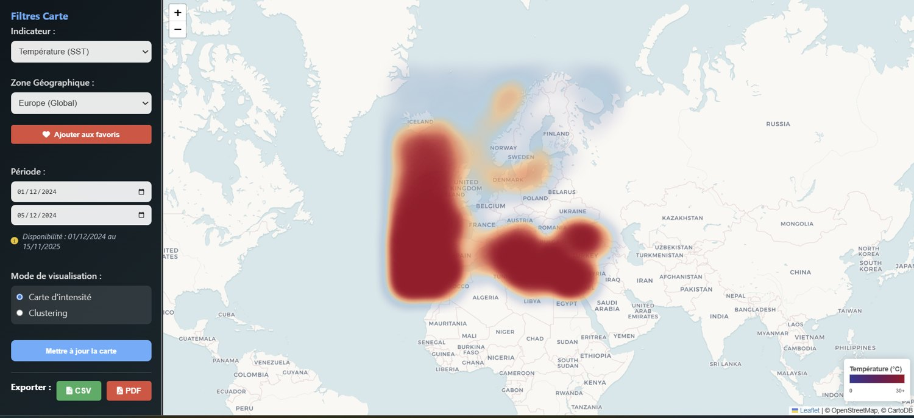

# OcéanView · Données marines sur carte et graphiques

OcéanView est une application web consacrée à l’exploration des données marines. Elle permet de consulter la température de surface (SST), la salinité de surface (SSS) ainsi que la concentration en chlorophylle-a (Chl-a) dans différentes zones maritimes européennes. Grâce à une carte interactive, des graphiques et des filtres par zone et par période, l’utilisateur peut comparer les mesures et suivre leur évolution dans le temps.

OcéanView est un projet universitaire. Dans l'application, les données utilisé proviennent de [Copernicus Marine](https://marine.copernicus.eu/) couvrant les années **2024 et 2025**.

La démonstration proposée dans ce dépôt génère **15 156 mesures fictives**, réparties sur **421 positions**, 12 dates et 3 variables. Les points couvrent la Manche, le golfe de Gascogne, la Méditerranée occidentale, l’Atlantique et la Baltique. [Aperçu de la carte de points](docs/carte-demo.jpg)

## Aperçu du site

### Accueil

[](docs/accueil-oceanview.png)

Page d’accueil d’OcéanView, donnant accès à la carte interactive, aux graphiques et aux favoris de l’utilisateur.

### Carte d’intensité

[](docs/carte-chaleur-oceanview.jpg)

Visualisation de la température de surface (SST) dans les zones maritimes européennes. Les filtres permettent de choisir l’indicateur, la zone géographique et la période à explorer sur les données fictives de démonstration.

### Graphique d’évolution

[](docs/graphique-chlorophylle.png)

Évolution de la concentration en chlorophylle-a (Chl-a), exprimée en mg/m³, sur la période sélectionnée. Le graphique permet de comparer les valeurs au fil du temps à partir des données fictives de démonstration.

## Lancer en local

Préparer Python 3.12 ou 3.14 avec pip et MySQL 8.4.

### Bibliothèques Python

- **Flask 3.1.3** : application web.
- **Flask-Caching 2.5.1** : mise en cache des résultats.
- **Flask-Login 0.6.3** : gestion des sessions utilisateurs.
- **Flask-WTF 1.2.2** : formulaires et protection CSRF.
- **mysql-connector-python 9.7.0** : connexion à MySQL.

### Préparer MySQL

Avec un compte d’administration MySQL, exécuter ce script.

~~~sql
CREATE DATABASE oceanview_demo CHARACTER SET utf8mb4;
CREATE USER 'oceanview'@'127.0.0.1' IDENTIFIED BY 'mot-de-passe-local-a-choisir';
GRANT ALL PRIVILEGES ON oceanview_demo.* TO 'oceanview'@'127.0.0.1';
~~~

Depuis la racine du dépôt, créer le fichier de configuration local.

### Windows PowerShell

```powershell
New-Item -ItemType Directory -Force instance
Copy-Item config.example.py instance/config.py
```

### macOS ou Linux

```sh
mkdir -p instance
cp config.example.py instance/config.py
```

Renseigner le mot de passe MySQL choisi dans `instance/config.py`, puis installer les dépendances, initialiser les données et démarrer l’application.

~~~sh
python -m pip install -r requirements.txt
python -m flask --app run init-demo
python run.py
~~~

Sur macOS ou Linux, utiliser `python3` à la place de `python` si nécessaire.

Ouvrir [localhost:5001](http://127.0.0.1:5001). La carte et les graphiques chargent des ressources externes. 

## Administration

L’espace `/admin/dashboard` est accessible aux comptes ayant le rôle **Admin**. Il rassemble trois vues.

- **Utilisateurs** — Consulter la liste des comptes, créer ou modifier un utilisateur, changer son rôle et supprimer un compte. L’administrateur connecté est protégé contre la suppression de son propre compte.
- **Logs système** — Consulter l’historique récent des actions enregistrées, avec leur date, l’utilisateur concerné et le détail.
- **Avis utilisateurs** — Lire les notes et les commentaires laissés sur le site.

Pour créer un compte administrateur dans la base de démonstration, exécuter la commande suivante depuis un terminal à la racine du projet, avec une adresse encore inutilisée dans cette base.

~~~sh
python -m flask --app run init-demo --admin-email kajan@example.test
~~~

Choisir un mot de passe d’au moins **8 caractères**, puis le confirmer. Démarrer le site avec `python run.py` et se connecter avec le compte créer.
## Architecture

[Voir le schéma d’architecture du projet](docs/architecture-oceanview.png)

Le projet d’origine a traité les données Copernicus Marine en Python avant de les charger dans MySQL. L’API Flask sert les mesures sélectionnées par zone, indicateur et période. Leaflet affiche la carte et Plotly les graphiques.

## Organisation du code

| Chemin | Rôle |
| --- | --- |
| `app/controllers/` | Routes Flask et API utilisée par la carte et les graphiques. |
| `app/models/` | Connexion MySQL, requêtes et accès aux comptes. |
| `app/templates/` et `app/static/` | Pages, carte et graphiques. |
| `app/schema_demo.sql` et `app/demo.py` | Schéma MySQL et génération des données fictives. |

[Projet dans le portfolio](https://kajan94.github.io/Portefolio/#oceanview)

## Travail en équipe

Projet universitaire réalisé à cinq en **deuxième année de BUT Informatique** à l’IUT de Créteil-Vitry (UPEC). Nous avons partagé les tâches entre le travail sur les données et le développement de l’application. Les crédits de l’équipe figurent aussi dans la page **À propos**.
