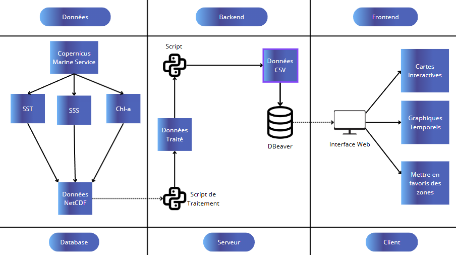

# OcéanView · Données marines sur carte et graphiques

Projet d’équipe réalisé à cinq en BUT Informatique à l’IUT de Créteil-Vitry. L’application associe une API Flask, une base MySQL, une carte Leaflet et des graphiques Plotly pour explorer la température et la salinité de surface ainsi que la chlorophylle-a.

## Essayer un parcours de bout en bout

1. Créer un compte de démonstration, puis ouvrir **Carte**.
2. Sélectionner **Europe (Global)**, **Température (SST)** et **Carte de points**. Pour la période du 1er janvier au 1er décembre 2025, le jeu de démo contient **192 valeurs de température** avant le regroupement selon le zoom.
3. Dans **Graphiques → Évolution**, reprendre la période et l’indicateur. Le tracé présente **12 valeurs**. La carte et les graphiques proposent aussi des exports CSV et PDF.

L’application d’origine a utilisé des données de [Copernicus Marine](https://marine.copernicus.eu/) pour 2024–2025. L’installation ci-dessous génère **576 mesures fictives**, réparties sur 16 positions, 12 dates et 3 variables. [Aperçu de la carte](docs/carte-demo.jpg) · [Crédits du fond OpenStreetMap](https://www.openstreetmap.org/copyright)

## Lancer en local

Préparer Python 3.12 ou 3.14 et MySQL 8.4. Avec un compte d’administration MySQL, exécuter ce script après avoir choisi un mot de passe local.

~~~sql
CREATE DATABASE oceanview_demo CHARACTER SET utf8mb4;
CREATE USER 'oceanview'@'127.0.0.1' IDENTIFIED BY 'mot-de-passe-local-a-choisir';
GRANT ALL PRIVILEGES ON oceanview_demo.* TO 'oceanview'@'127.0.0.1';
~~~

Depuis la racine du dépôt, créer un environnement virtuel avec `python -m venv .venv`. Activer `.\.venv\Scripts\Activate.ps1` sous PowerShell ou `source .venv/bin/activate` sous macOS et Linux. Créer le dossier `instance/`, copier `config.example.py` vers `instance/config.py` et renseigner le mot de passe choisi.

~~~sh
python -m pip install -r requirements.txt
python -m flask --app run init-demo
python run.py
~~~

Ouvrir [localhost:5001](http://127.0.0.1:5001). La carte et les graphiques chargent des ressources externes. L’option `--admin-email admin@example.test` de `init-demo` permet de créer un compte d’administration local avec un mot de passe choisi au lancement.

## Architecture et carte de chaleur

Le projet d’origine a traité les données Copernicus Marine en Python avant de les charger dans MySQL. L’API Flask sert les mesures sélectionnées par zone, indicateur et période. Leaflet affiche la carte et Plotly présente les séries temporelles.

Capture du projet d’origine. Le fond de carte est crédité dans l’image. La version publique fournit son propre jeu de démonstration.

## Suivre une donnée dans le code

Le script [app/demo.py](app/demo.py) peuple le schéma [app/schema_demo.sql](app/schema_demo.sql). Les modules `app/models/` lisent la base. Les contrôleurs `app/controllers/` transmettent les résultats aux vues et au JavaScript. La page **À propos** de l’application présente l’équipe.

[Projet dans le portfolio](https://kajan94.github.io/Portefolio/#oceanview)
